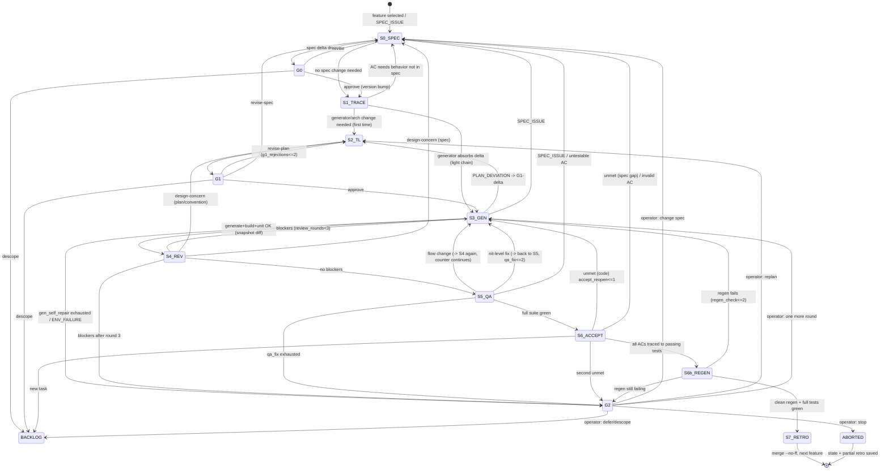

# Workflow gap analysis: planning scratch

> **Author:** Opus gap-analysis agent (AI-written). Not human-authored.
> **Date:** 2026-10-13
> **Inputs read:** `docs/brief/aware-test-brief.md`, `docs/PROJECT_CONTEXT.md`, `docs/human-input/OPERATOR_MESSAGES.md`, `generator/WORKFLOW.md` (v0.1), `README.md`, `AGENTS.md`, `DESIGN.md`, `spec/README.md`, `docs/retros/TEMPLATE.md`.
> **Status:** scratch for the operator. Nothing here has been built or decided. `WORKFLOW.md` v0.1 points to this file at `docs/planning/workflow-gap-analysis.md`. It was written to `/mnt/user-data/outputs/`, so ORC needs to copy it to that path.
> **Staging note:** `README.md` marks `CLAUDE.md`, `FUTURE.md`, `docs/decisions/`, `generator/README.md`, `.claude/` and `spec/scenarios/alice-bob-offline.md` as present (✔ or linked). None of them were in the staged copy, so check that they exist before relying on them.

---

## 1. Summary

- **The plan mixes up two machines.** The operator describes a delivery pipeline (PM→TL→G1→DEV→REV→QA→PM). The brief grades a generator: "if we delete the generated client code and run your generator, we get back working clients" (primary criterion). In v0.1, DEV writes client code from TL plans. That code cannot be reproduced from `spec/` alone, so graders who regenerate would get something different or broken. **Fix:** the pipeline builds and evolves the spec and the generator. Client code only comes from running the generator. DEV never hand-writes `clients/*`. Review or QA findings on generated code turn into spec or generator fixes followed by a regeneration, never into patches. GAP-11 is the most important gap in v0.1.
- **There are three competing sources of truth.** The spec has no owner (GAP-02). The ACs (`docs/product/ACCEPTANCE_CRITERIA.md`) and TL plans (`docs/plans/...`) would both hold behavior the spec does not. The brief scores "Behavior questions resolved by reading the spec, not the code". ACs should become a traceability matrix that points at spec IDs. Any client "HOW" that the generator needs must move into generator inputs (`spec/platform/*`, `generator/conventions/*`).
- **QA's "robust unit and UI tests" will be deleted on regeneration** if they live inside `clients/*`. Durable tests have to live outside the boundary (`tests/`) and drive clients through stable hooks that the spec defines (test IDs, a driver interface).
- **The workflow has no spec stage and no spec gate.** The operator approves TL plans (G1), but the artifact graders read and treat as authoritative is the spec. The human gate should sit mainly on spec deltas (new G0). G1 should be reserved for architecture and generator design.
- **Backward transitions are mostly missing.** There is no path for spec ambiguity, plan deviation, reviewer disagreement with the plan, untestable ACs, or a failed regeneration. Only the S4 loop has a counter. The S5 and S6 loops, G1 rejections and spec re-opens are unbounded. §4 and §6 propose a full state machine with counters, an escalation path and an abort path.
- **Regenerating from empty is never exercised inside the loop.** Features are built incrementally, but graders regenerate the whole client from nothing. Each feature's acceptance should include a delete-and-regenerate check (new S6b), at least per epic.
- **Attribution is currently inaccurate.** `README.md` labels `spec/`, `DESIGN.md`, `AGENTS.md`, `generator/`, `server/` and `tests/` as "Hand-written", but under this pipeline agents draft almost all of them. Track two separate axes: regeneration boundary (generated vs maintained) and authorship (human / agent-drafted, human-approved / agent). Record both in commit trailers and a machine-readable run log.
- **The process is too heavy for a take-home.** The full 6-agent chain for every feature and every app, plus a separate PM accept on top of QA, plus a full pipeline for a server that is explicitly outside generator discipline, will take most of the time budget. I recommend a full chain for first-time and architecture work, a light chain for later deltas, and automated acceptance.

---

## 2. Brief alignment check

### 2.1 "How we evaluate" table

| Brief signal | Produced by the planned workflow? | Where | Missing / risk |
|---|---|---|---|
| **DESIGN.md**: "Shows your design principles." | Partly. `DESIGN.md` exists as a draft; Phase 0 mentions it. | §4.0 | No stage owns updating it. Its open questions (transport, IDs, delivery semantics, scenario encoding) block the spec, and no stage resolves them. Add DESIGN/decision updates as an output of G0 and G1. Add a principle for "pipeline builds generator; generator builds clients". |
| **CLAUDE.md, AGENTS.md, etc.**: "Looking at your setup." | Partly. Phase 0 creates `.claude/agents/`, prompts, `/pipeline`. | §4.0, §6, §7 | `AGENTS.md` §Roles still says "detailed handoffs will be defined". It needs to describe both entry points (`/pipeline` for delivery, `/generate` for regeneration). Prompt templates must be committed and parameterised. If ORC writes a fresh prompt for every launch ("having proper prompts for each agent"), the setup cannot be reproduced. |
| **Generated vs hand-written**: "Mark the boundary in your README" | Partly. README boundary section, `.generated` marker, header string. | README §Regeneration boundary; E-DEV-1 | (a) If DEV writes clients directly, "generated" is false in the brief's sense: the generator did not produce it. (b) Files that cannot hold comments (`package.json`, lockfiles, the binary `gradle-wrapper.jar`) cannot carry the header. Use a manifest. (c) README says `clients/*/` "(except README)". The boundary should be a whole directory, so graders can `rm -rf clients/android`. |
| **Author attribution**: "Mark which artifacts you wrote vs. delegated" | Weak. `OPERATOR_MESSAGES.md` plus README authorship table. | README §Authorship; `OPERATOR_MESSAGES.md` | The table says "Hand-written" for agent-drafted artifacts. There is no per-commit authorship convention and no per-stage record of which agent or model produced what. The retro template has a model column but no authorship or approval fields. See §7. |
| **Commit history**: "do not check in a single final output" | Not defined (GAP-12). | §4.2 S7 "commits" | The only commit point is S7, which produces one commit per feature, close to "single final output" per feature. Stages are invisible. Define commit-per-stage on feature branches merged with `--no-ff`, with trailers. Regeneration commits must be separate from spec and generator commits so graders can see "spec change → regen". |
| **Regeneration works** (**primary criterion**) | Not covered. E-PIPE-1 names it but no stage produces it. | §9 E-PIPE-1; GAP-11 | No `/generate` command, no headless mode, no pinned model, no self-repair loop, no template for binary or build-infra files, no clean-room verification step. Gated human stages must not be part of regeneration. See §2.3. |
| **Spec is authoritative** | At risk. | AGENTS.md rules; GAP-02 | The spec has no owner or stage. ACs and TL plans can carry behavior. E-PIPE-2 cannot be tested as written. See §2.4. |
| **Two clients interoperate through the server** | Not planned. | E-QA-1 mentions the Alice/Bob scenario | No interop test harness and no cross-app stage. Per-app QA cannot prove interop. Scenarios need both pairings (Android-Alice/Web-Bob and swapped). Sequencing (server first) is GAP-13. |
| **Evolution**: "could we write additional rules into spec… attachments, reactions, group conversations" | Implicit only. `spec/extensions/`, DESIGN principle 5. | Triggers table "Spec changes" row | Nothing shows the harness is generic. Nothing stops prompts from hard-coding "login/chat". No extension demo is planned. TL "first time" planning per feature suggests every new feature needs a new human-approved plan. That is the opposite of "would the harness still generate working clients given good spec extensions". See §2.6. |
| **Workspace shape** | Yes, from the shell. | README layout | Missing locations: maintained tests that must survive regeneration (`tests/android-conformance`, `tests/web-e2e`), `generator/templates/`, `generator/conventions/`, `docs/runs/`. Decide whether `docs/plans/` survives (see Q3). |
| **Quality**: "what did you do to test this is working" | Partly. REV/QA stages, evals. | §4.2, §9 | QA tests inside the boundary get wiped. No conformance suite tied to spec IDs. No flakiness or determinism check across regenerations. Android UI testing in a sandbox without an emulator is not addressed. |
| **FUTURE.md** (optional) | Not mentioned in WORKFLOW. | — | Feed it from the retros' "what to improve" sections at packaging. |

### 2.2 Deliverables list

| Deliverable | Planned? | Gap |
|---|---|---|
| Git repo(s) as zip/archive | No packaging step. | Add a packaging phase: `git bundle` or zip that includes `.git`, then an unzip-and-regenerate test in a clean sandbox. |
| README: **agentic harness** | Partly ("generator/, .claude/"). | Must explain the two entry points and the agent roster. Link `WORKFLOW.md`. |
| README: **spec** | Yes (`spec/`). | — |
| README: **generator: what to run, in which tool** | ☐ "to be defined". | Exact command, tool version, model ID, expected run time, prerequisites (JDK, Android SDK, Node). |
| README: **generated client code, committed, boundary marked** | Partly. | Committed output must be the result of a clean `/generate` run, not of incremental DEV patches. Record spec version and generator commit in the manifest. |
| **Server**, not under generator discipline | Yes (hand-maintained). | It would be overkill to run the full pipeline for it (Q6). Its authorship needs honest labelling (agent-written vs hand-written). |
| FUTURE.md | Listed in README ✔ but not in staged copy. | Verify it exists. |

### 2.3 Tension: human-gated delivery pipeline vs reproducible generator

The operator wants the pipeline to be "replicable and possible to be launched without human-in-loop" with "one point of start". The brief wants graders to "follow your README, get working clients". These are different requirements:

| | Delivery pipeline (`/pipeline`) | Generator (`/generate <client>`) |
|---|---|---|
| Purpose | Evolve spec, generator, server and tests | Rebuild `clients/<x>` from `spec/` + `generator/` |
| Who runs it | Operator (interactive) or ORC (autonomous) | Graders, CI, and the pipeline's own S3/S6b |
| Human gates | G0, G1, G2 | **None**. Must be headless (`claude -p` or a slash command), bounded and deterministic in structure |
| Inputs | Brief, backlog, operator | `spec/` (versioned), `generator/` (prompts, conventions, templates), pinned model |
| Quality gates | REV, QA, acceptance | Automated: build → unit tests → conformance tests → bounded self-repair (≤N) → fail loudly |
| Output | Commits to spec/generator/server/tests | `clients/<x>/**` + `.generated` manifest |

**Proposed default.** DEV in the per-feature loop edits only generator inputs (prompts, conventions, templates, `spec/platform/*`) and then **invokes `/generate`**. REV and QA judge the generated output, and every fix goes back into generator inputs. That makes "regenerate" the normal way of working, so graders exercise a path that has run dozens of times. An alternative is DEV writing clients directly and the generator reproducing them later ("snapshot then reverse-engineer prompts"). That is much riskier and should be rejected.

### 2.4 Spec authoritative vs PM ACs and TL plans

- `WORKFLOW.md` §3 puts ACs in `docs/product/ACCEPTANCE_CRITERIA.md` and TL plans in `docs/plans/<feature-id>/<app>.md`. Neither is a generator input in the brief's sense, but both will hold behavior: PM writes "WHAT" and TL writes "HOW".
- **Rule to adopt:** an AC may only restate or reference spec IDs (`CORE-xxx`, `SC-xx` scenario steps). If PM needs a behavior that is not in the spec, that is a **spec delta** and goes through G0. The AC document becomes `docs/product/TRACEABILITY.md`: brief requirement → spec ID → AC ID → test ID → status.
- **TL plans** split into two kinds:
  - Durable client "HOW" the generator needs (module layout, DI graph, threading rules, library versions) goes into `spec/platform/<app>.md` (behavioral platform rules) or `generator/conventions/<app>.md` (code-shape rules). Both are committed generator inputs.
  - Ephemeral task breakdown stays in `docs/plans/` as history only, and the generator never reads it.
- If a TL plan is invalidated, that is evidence the spec or conventions were incomplete, and it creates a spec or convention delta.

### 2.5 Marking generated vs hand-written when agents write everything

There are two independent axes. README conflates them.

| Axis | Values | Mechanism |
|---|---|---|
| **Regeneration boundary** (brief's "generated vs hand-written") | `generated` (rebuilt by `/generate`) / `maintained` (not regenerated) | Directory-level: `clients/*` only. `clients/<x>/.generated` manifest lists files + sha256 + spec version + generator commit + model ID. Header on every file that supports comments. |
| **Authorship** (brief's "Author attribution") | `human` / `agent-drafted, human-approved` / `agent` | Commit trailers (`Authored-By-Role: human\|agent`, `Agent: TL`, `Model: claude-opus-…`, `Approved-By: operator`, `Stage: G0`), the README authorship table, and the run log. |

The README table should then read something like this:

| Path | Boundary | Authorship |
|---|---|---|
| `spec/core` | maintained | agent-drafted, human-approved at G0 |
| `server/` | maintained | agent |
| `clients/*` | generated | agent via generator |
| `docs/human-input/` | maintained | human |

### 2.6 Evolution

- The harness must read `spec/README.md`, `spec/extensions/*` and the capability list dynamically. Prompts must not name features. Add a lint eval: a grep over `generator/prompts/` for feature nouns (login, chat, queue) outside example blocks.
- Phrases like "first time to implement (each individual feature)" for TL planning should become: TL plans when the **generator or architecture** must change, not whenever a new feature appears. A good extension spec should regenerate without TL involvement. That is the claim graders test.
- **Plan an evolution demo:** one small extension (e.g. reactions or read receipts) added as `spec/extensions/<x>.md`, regenerated with the generator unchanged or minimally changed, then passing extended scenarios. The commit history shows "spec-only commit → regen commit → tests green". This is the strongest evidence for the Evolution row.

---

## 3. End-to-end step list (now → submission)

`[H]` = human gate. `[A]` = automated gate (no human).

**Phase 0: Harness and workflow decisions**
1. `[H]` Operator answers §5 questions. ORC updates `WORKFLOW.md` to v0.2 and records decisions in `docs/decisions/`.
2. Repo hygiene: `.gitignore` `.work/`; commit-trailer convention in `AGENTS.md`; verify `CLAUDE.md`, `FUTURE.md` and `docs/decisions/` exist.
3. Scripts in `generator/scripts/`: `snapshot-diff` (patch + meta + numstat), `count-lines` (REV model rule), `run-log` (append JSONL event), `check-headers` (manifest + headers), `check-trace` (spec ID ↔ AC ↔ test coverage), `regen-check` (clean-room delete + regenerate + test), `lint-commits`.
4. Agent role files `.claude/agents/{pm,tl,dev,rev,qa}.md`. Prompt templates `generator/prompts/<role>.md` with variables only.
5. Entry points: `/pipeline` (delivery, with interactive and autonomous modes) and `/generate <android|web|all>` (headless). `generator/RUN.md` as the fallback.
6. `STATE.json` schema + run-log schema (§7).
7. `[H]` Operator reviews the Phase 0 harness (G1 for the harness itself). Commit.

**Phase 1: Backlog and core spec**
8. PM: `BACKLOG.md` (vertical features: F1 identity, F2 send/receive, F3 offline queue/flush, F4 Alice/Bob interop, F5 evolution demo) + `TRACEABILITY.md` skeleton (brief requirements BR-1..4, SC-1..7).
9. TL + PM: decision records for transport, message identity, ordering, delivery semantics, web stack, Android test strategy.
10. TL + PM: `spec/core/{protocol,client-behavior,server-behavior}.md` with `CORE-xxx` IDs. Machine-readable contract (JSON Schema/OpenAPI) in `spec/core/schema/`. Alice/Bob expected states per step. Test-hook contract (test IDs / driver API) in `spec/platform/*`.
11. `[A]` `check-trace`: every BR and SC step maps to a spec ID.
12. `[H]` **G0**: operator approves spec v0.1.0. Tag `spec-v0.1.0`.

**Phase 2: Server and contract tests (maintained, light chain)**
13. TL server plan (short) `[H]` G1-light.
14. DEV server + `tests/protocol/` (Python conformance against `spec/core/schema` + scripted fake clients that run Alice/Bob against the real server).
15. REV (≤3 loops). `[A]` conformance green. Commit.

**Phase 3: Generator v1**
16. TL: generator design per platform: deterministic templates (Gradle wrapper, settings, module skeletons, Vite/tsconfig), `generator/conventions/{android,web}.md`, generation order (core/network → data → features), self-repair bound, manifest format. `[H]` **G1**.
17. DEV: implement the generator (prompts, templates, `/generate`, self-repair loop, manifest writer).
18. `[A]` First `/generate android` and `/generate web` (parallel, separate worktrees). Build + unit tests.

**Phase 4: Per-feature loops (F1 → F3)**, per §6 state machine:
19. S0 spec delta (if any) `[H]` G0 → S1 trace/ACs → (S2 TL only if generator or architecture change, `[H]` G1) → S3 generator change + `/generate` → S4 REV ≤3 → S5 QA (maintained tests in `tests/`) → S6 automated acceptance (+ PM only on exceptions) → `[A]` **S6b regen-check** (clean delete + regenerate + full test) → S7 retro + merge `--no-ff`.

**Phase 5: Interop**
20. QA: `tests/interop/`: one script starts the server and runs Alice/Bob for both pairings (Android core in JVM or emulator + web via Playwright). `[A]` green ×3 for flakiness.
21. Demo artifact: a script and/or a recorded log/GIF referenced from README.

**Phase 6: Evolution demo**
22. F5: extension spec `[H]` G0 → `/generate` with no or a minimal generator change → extended scenario passes → retro notes what the harness needed.

**Phase 7: Regeneration verification**
23. `[A]` Fresh clone → `rm -rf clients/*` → `/generate all` with pinned model → build → conformance + interop. Run twice. Keep the logs in `docs/runs/regen-verification.md`.
24. `[H]` Operator runs step 23 once by hand, following only README (the grader simulation).

**Phase 8: Packaging**
25. Finalise README (where-to-find table, boundary, authorship two-axis table, commands, run time, prerequisites), DESIGN.md, AGENTS.md/CLAUDE.md, FUTURE.md (from retros).
26. `[A]` `lint-commits`, `check-headers`, `check-trace`, link checker.
27. `[H]` Final operator review. Create the archive, unzip it in a clean sandbox, run step 23 once more, and submit.

---

## 4. Gaps

### 4.1 Existing GAP-01..13 (confirmed or refined)

| ID | Verdict | Refinement | Proposed default |
|---|---|---|---|
| GAP-01 QA model | Confirm | Model should depend on task: scenario and interop test design needs reasoning; adding tests per AC is mechanical. | Opus for designing the conformance/interop suite (once per app); Sonnet for adding tests to an existing suite. Log the choice. |
| GAP-02 Spec owner | Confirm, **elevate to P0** | Merge with AC/plan source-of-truth concern (§2.4). | PM drafts `client-behavior` + scenarios (WHAT). TL drafts `protocol`, `server-behavior`, `platform/*` (contract-level HOW). Operator approves at G0. Only S0 may edit `spec/`. |
| GAP-03 Commit reports? | Confirm | Evaluators read history; scratch evidence is lost. | `.work/` git-ignored. Commit condensed `docs/runs/<feature>/{run.jsonl, review-<n>.md, qa.md, acceptance.md}`. |
| GAP-04 Gate on backlog/ACs | Refine | The gate belongs on the spec, not on ACs. | Light `[H]` on backlog once (Phase 1). ACs need no gate if they are only spec references (enforced by `check-trace`). |
| GAP-05 Unmet AC | Confirm | Also needs a classification. | Unmet because of code → S3 (reopen, counter `accept_reopen` ≤1). Unmet because of spec gap → S0. AC invalid → PM edits AC only if no spec change is needed. Otherwise S0. A second unmet → G2. |
| GAP-06 QA-triggered counter | Confirm | | The review counter **continues** within a feature (no reset), so the total cap is 3 review rounds per app per feature. A separate `qa_fix` counter ≤2. |
| GAP-07 PM evidence | Confirm | | Evidence = test run artifacts (JUnit XML / Playwright report) mapped to AC IDs via `check-trace`, plus the interop log for scenario ACs. No PM "looks at the app". |
| GAP-08 400 lines | Refine | Generated code is what gets reviewed, so excluding it makes the rule meaningless. First generation of a module is always far above 400. | Count insertions+deletions from `git diff --numstat <base>...<head>`. Exclude lockfiles, wrapper/binaries, `.generated` manifest and snapshot files. Opus is forced for first generation of a module and for any concurrency/threading-touching diff (path heuristic: `**/sync/**`, `**/network/**`, queue). Record the number in `diff.meta`. |
| GAP-09 Autonomous gates | Confirm | | G0: halt (never auto-approve spec). G1: auto-approve only if E-TL evals pass, with the rationale logged and the decision flagged for later operator review. G2: halt that feature, mark it `blocked`, continue with independent features. Budget exceeded: halt. |
| GAP-10 Nits | Refine | In generated code, a nit fixed in code is overwritten by the next regeneration. | A nit that is a *pattern* (magic numbers, naming) becomes a rule in `generator/conventions/*` and is fixed on the next regen. Other nits are deferred to the retro. Nits never block QA. |
| GAP-11 Pipeline vs generator | Confirm, **elevate to P0** | See §2.3. | Two entry points. DEV changes generator inputs and runs `/generate`. Never hand-patch `clients/*` (consistent with AGENTS.md "Never hand-edit generated code", which v0.1's S3/S4 loop currently contradicts). |
| GAP-12 Branch/commit | Confirm | | Branch `feat/<id>`. One commit per stage output (spec delta, generator change, regen, review fixes, tests, retro) with trailers. Merge `--no-ff`. No squash. Tag spec versions. |
| GAP-13 App order | Confirm | | Spec core → server + protocol conformance → generator → clients in parallel. The contract schema in `spec/core/schema` is the cross-app interface. |

### 4.2 New gaps

| ID | Gap | Why it matters | Proposed default |
|---|---|---|---|
| **GAP-14** | **No spec stage (S0) and no spec gate (G0).** `WORKFLOW.md` §5 has "Spec changes (GAP-02) → Regenerate" as a trigger, but no stage produces spec changes. | Spec is authoritative; evolution. | Add S0 Spec delta (PM+TL draft, ORC bumps version) + G0 operator approval. |
| **GAP-15** | **Backward transition: spec ambiguity found downstream** (DEV, REV, QA, S6). | Without it, agents fill gaps in code, so behavior ends up living only in code (fails "Spec is authoritative"). | Any agent may return `SPEC_ISSUE{spec_id, question}`. ORC pauses the feature and routes to S0. After G0, re-enter at S1 (trace), then S3 for **all** affected apps. Re-run S6b for previously accepted features if a `CORE` ID changed. Counter `spec_reopen` ≤2 per feature, then G2. |
| **GAP-16** | **Backward transition: G1 rejection reasons.** v0.1 only allows "changes → S2". | The operator may reject because the AC or spec is wrong, not the plan. | G1 outcomes: `approve`, `revise-plan` → S2, `revise-spec` → S0, `descope` → backlog. `g1_rejections` ≤2 before ORC asks the operator for a sync discussion instead of another round. |
| **GAP-17** | **Plan invalidated during DEV.** | DEV silently deviates, or burns loops. | DEV returns `PLAN_DEVIATION{reason, proposal}`. ORC → TL amends (delta only) → G1-delta (single yes/no, may be auto in autonomous mode if within the plan's scope). DEV does not continue on an unapproved deviation. |
| **GAP-18** | **Reviewer disagrees with the plan or spec**, not the code. Only "blocker/nit" exist. | Without a third category, a plan defect causes endless blocker loops on DEV. | Add finding category `design-concern` (target: plan, spec or convention). Design concerns don't count against `review_rounds`. ORC routes them to TL (plan or convention) or S0 (spec). |
| **GAP-19** | **Loop counters only exist for S4.** QA↔DEV, S6 reopen, G1, spec reopen, generator self-repair and regen-check retries are unbounded. Also "max of 3" is ambiguous (3 reviews or 3 fix rounds?). v0.1 says both "Counter > 3 → G2" and "4th review loop would start". | Termination; autonomous mode could loop forever. | Counters in `STATE.json` per feature per app: `review_rounds` (R1 = first review; after R3 still has blockers → G2), `qa_fix` ≤2, `accept_reopen` ≤1, `g1_rejections` ≤2, `spec_reopen` ≤2, `gen_self_repair` ≤3 per `/generate` run, `regen_check` ≤2. Plus a per-feature budget (wall time, tokens). Any counter exceeded → G2. |
| **GAP-20** | **Failure and abort paths.** No handling for agent crash or timeout, broken build environment (no Android SDK or emulator), a generator run that can't converge, operator "stop", or rollback. | Autonomous mode; reproducibility in graders' sandbox. | States `BLOCKED` (with reason) and `ABORTED`. Abort = keep the branch, write STATE, write a partial retro. Rollback = reset the feature branch to the last green stage commit. An environment failure is never retried more than once; it escalates. Phase 0 includes an environment preflight script (JDK, Android SDK, Node, Python versions). |
| **GAP-21** | **Cross-app contract.** Clients and server have no shared machine-checkable interface. Interop is only tested at the end. | "Two clients can work with each other". | `spec/core/schema/` (JSON Schema or OpenAPI) + `tests/protocol/` run against the server. Generated clients validate their fixtures against the same schema. Interop suite in `tests/interop/`, both pairings. |
| **GAP-22** | **Durable tests vs regeneration.** QA writes "robust unit and ui testing" (operator), but anything in `clients/*` is deleted. | Quality; Regeneration works. | Two tiers. Generated unit tests inside `clients/*` (DEV-level). Maintained black-box tests outside (`tests/protocol`, `tests/interop`, `tests/web-e2e`, `tests/android-conformance`) driven via test hooks the spec defines. QA owns the maintained tier. |
| **GAP-23** | **Testability hooks are unspecified.** UI tests on regenerated code break if element IDs or test tags vary between runs. | Regeneration determinism; Quality. | `spec/platform/{android,web}.md` defines mandatory test tags / `data-testid`s and (Android) a JVM-testable core module API, so Alice/Bob can run without an emulator. |
| **GAP-24** | **Regeneration from empty never runs during development.** | Primary criterion is only tested at the end. | S6b regen-check per feature (or per epic at minimum): fresh worktree, delete boundary, `/generate`, full tests. |
| **GAP-25** | **Non-determinism and pinning.** Different model, prompt or dependency versions mean different clients. | Reproducibility. | Pin model IDs in `generator/config` (record them in the manifest). Pin dependency versions in templates (`libs.versions.toml`, `package.json` with exact versions + committed lockfile template). Copy binary infra (Gradle wrapper jar) from `generator/templates/` instead of generating it. |
| **GAP-26** | **Parallel safety beyond file sets.** A shared git working tree and index, concurrent commits, shared root files (README, `.gitignore`, `settings.gradle`), and both apps wanting spec edits. | Correctness of parallel runs. | One git worktree per parallel agent (`.work/wt/<feature>-<app>`). `spec/` and root files are serialised through ORC. Parallelism allowed only for DEV/REV/QA of different apps after G0/G1. ORC merges worktrees sequentially and re-snapshots the diff. Log the decision in run log. |
| **GAP-27** | **Diff-file staleness and shape.** `diff.meta.head == HEAD` doesn't cover uncommitted changes, parallel worktrees or base drift. A whole-app first generation produces an unreadable multi-MB patch. | Wrong review or test target. | Rule: ORC commits (WIP allowed) before every handoff, so the diff is commit-addressed. Meta: `{base_sha, head_sha, worktree, porcelain_clean, patch_sha256, numstat, changed_lines, created_at, stage}`. Every agent's first step is a self-check (HEAD and clean status) and returning `STALE_DIFF` if it fails. Above about 2,000 lines, the snapshot includes a file list plus per-module patches, and agents read the files. |
| **GAP-28** | **"First time" is undefined** (S2 trigger; DEV Opus rule). | Wrong model and gate choice. | "First" = the module or app has no generated code yet, **or** the generator/conventions must change. Spec-only deltas that the generator absorbs are not first time. |
| **GAP-29** | **Model selection rationale is not logged.** "Opus again only if you think he is going to need to interpretate". | Cost; auditability; retro. | Every launch logs `model`, `model_id`, `reason`. Default Sonnet; Opus triggers listed explicitly (first generation, concurrency paths, `design-concern` follow-up, previous Sonnet attempt failed). |
| **GAP-30** | **Cost and time budget.** Opus TL + Opus first DEV + Opus REV for every first generation, across 3 apps and ≥4 features. | Take-home time box. Commit history should show the time spent well. | Budget per feature in STATE (soft and hard caps). The retro records actuals. Use the light chain (Q4). |
| **GAP-31** | **Who maintains the retro and operator-message logs, and how they are verified.** ORC copies operator messages "verbatim". Nothing checks this. The AI-written "_Triggered:_" notes sit inside a human-attributed file. | Author attribution. | ORC appends and the operator confirms in the same commit (trailer `Approved-By: operator`). Or the operator pastes the entry themselves. Move AI notes to a separate column or file, or prefix them `AI note:`. Retros are generated from `run.jsonl` (no free recall), then ORC adds narrative, and the operator adds a "Human notes" section. |
| **GAP-32** | **Prompts are written ad hoc by ORC.** | Reproducibility; "Looking at your setup". | Templates in `generator/prompts/`. ORC only fills variables. The rendered prompt hash goes into the run log. |
| **GAP-33** | **STATE is Markdown** (`.work/STATE.md`), which ORC must parse on resume. | Resumability; autonomous mode. | `.work/STATE.json` (schema-validated) + optional rendered `STATE.md` for humans. |
| **GAP-34** | **ORC context exhaustion** over long runs. | Autonomous mode reliability. | ORC must be able to resume statelessly from STATE.json + run log. Checkpoint after every transition. |
| **GAP-35** | **Generated-marker coverage.** Header impossible for JSON, binaries, lockfiles. README boundary says "except README". | Boundary clarity; graders delete precisely. | The `clients/<x>/.generated` manifest is authoritative (paths + hashes). Headers where possible. The whole directory is generated, README included. `check-headers` verifies manifest == tree. |
| **GAP-36** | **Regression across features.** Feature N's regeneration can break feature N-1. | Regeneration works. | S5 always runs the full maintained suite, not just new tests. S6b is a full regeneration. |
| **GAP-37** | **Sandbox capability for Android.** Emulator availability in graders' sandbox is unknown. | "We should be able to duplicate your results in a sandbox". | Primary verification is JVM (Robolectric / Compose JVM tests + core module against the real server). Emulator-based UI tests are optional and documented. |
| **GAP-38** | **Server lives outside the generator but inside the pipeline**, and it has no authorship story. | Deliverables: server "does not have to be under generator discipline". | Light chain (TL-lite → DEV → REV → protocol tests). Labelled `maintained / agent` honestly. Or the operator hand-writes it as an attribution win (Q6). |
| **GAP-39** | **Packaging and archive verification** are absent. | Deliverables. | Phase 8 steps 25 to 27. |
| **GAP-40** | **Evolution not demonstrated, and harness genericity not enforced.** | Evolution. | F5 extension demo + prompt lint (no feature nouns in generator prompts). |
| **GAP-41** | **The operator's "launch an Opus agent to build the first phase"** (first line of the 12:51 instruction) has no corresponding Phase 0 exit criteria. | Scope creep in Phase 0. | Phase 0 exit = steps 1 to 7 in §3, plus a dry run of `/pipeline` on a trivial dummy feature with the mock stages. |
| **GAP-42** | **PM ACs per app for UI differences** ("generic vs platform specific extensions" in the brief). | The brief wants that thinking shown. | Traceability rows are tagged `core` vs `platform:android` vs `platform:web`. Platform rows must reference `spec/platform/*` IDs (`AND-xxx`, `WEB-xxx`). |

---

## 5. Questions for the operator

Each question has options and a recommendation (**Rec**).

1. **How do the pipeline and the generator relate?**
   (a) The pipeline evolves spec and generator; clients come only from `/generate`. (b) DEV writes clients directly, and the generator is built later to reproduce them. (c) The pipeline in autonomous mode *is* the generator.
   **Rec (a).** (b) risks the primary criterion. (c) makes graders run a 6-agent chain with gates and adds cost and variance.

2. **Who owns `spec/`?**
   (a) PM drafts behavior and scenarios, TL drafts protocol and platform, operator approves at G0. (b) ORC writes the spec. (c) The operator hand-writes the core protocol, and agents draft the rest.
   **Rec (a)**, plus (c) for the 3 to 5 core protocol decisions (transport, IDs, ordering, delivery) as decision records written in the operator's own words. That gives graders a strong attribution signal for the most important design choices.

3. **Where should the main human gate sit?**
   (a) G1 on every TL plan (as now). (b) G0 on every spec delta, plus G1 only for architecture or generator design changes. (c) Both on every feature.
   **Rec (b).** The spec is what graders read. TL plans for clients become generator inputs.

4. **Does every feature need the full PM→TL→G1 chain?**
   (a) Yes, always. (b) Full chain for the first feature per app and for generator or architecture changes; a light chain (S0 spec delta → G0 → S3 regen → S4 → S5 → S6 automated) for later features. (c) Light chain always, with TL on demand.
   **Rec (b).**

5. **Is PM acceptance (S6) redundant with QA once ACs map to tests?**
   (a) Keep a separate PM agent run per feature. (b) Replace it with an automated `check-trace` (every AC has a passing test), and call PM only when the check fails or a test is missing. (c) PM accept once per epic.
   **Rec (b).** It saves a Sonnet run per feature and produces better evidence.

6. **Does the server need the full pipeline?**
   (a) Full chain. (b) Light chain: TL-lite plan → DEV → REV → `tests/protocol`, with no separate QA and no PM accept. (c) The operator hand-writes the server (about 150 lines of Python) and agents only review it.
   **Rec (b).** Choose (c) if time allows, because it gives the cleanest attribution story. The brief says "Don't over invest there".

7. **Build order?**
   (a) Spec → server + protocol tests → generator → clients. (b) Clients against a mock server in parallel with the server. (c) Server last.
   **Rec (a).**

8. **Where do QA's "robust" tests live?**
   (a) Outside the boundary (`tests/`), maintained, black-box via spec-defined hooks. (b) Generated inside `clients/*`. (c) Both: generated unit tests inside, maintained conformance and interop outside.
   **Rec (c).**

9. **How do gates behave in autonomous mode?**
   (a) Auto-approve everything, with the rationale logged. (b) Halt at every gate. (c) Halt on G0 and G2, auto-approve G1 when its evals pass (flagged for later review), and continue with independent features when one is blocked.
   **Rec (c).**

10. **What does the review cap of 3 mean?**
    (a) 3 review rounds per app per feature in total, including QA-triggered re-reviews (no reset). (b) 3 per entry into S4 (QA flow change resets the count). (c) 3 per feature across all apps.
    **Rec (a).**

11. **Nits?**
    (a) Fix all before QA. (b) Pattern nits become generator conventions (fixed on the next regen), others are deferred to the retro, and nits never block. (c) Ignore nits.
    **Rec (b).**

12. **Commit granularity?**
    (a) One commit per stage output on `feat/<id>`, merged `--no-ff`. (b) Squash per feature. (c) Commit per feature only.
    **Rec (a).** "Commit history matters".

13. **Commit authorship identity?**
    (a) All commits use the operator's git identity with trailers (`Agent:`, `Model:`, `Approved-By:`). (b) Agent commits use a distinct author (e.g. `Aware Agent (DEV/opus) <agent@local>`) with the operator as committer. (c) Mixed by area.
    **Rec (b).** It makes `git log --author` attribution trivial for graders. Keep trailers too.

14. **Should review, QA and acceptance reports be committed?**
    (a) Keep them all git-ignored. (b) Commit condensed `docs/runs/<feature>/` (run.jsonl + final reports). (c) Commit all of `.work/`.
    **Rec (b).**

15. **Model pinning for `/generate`?**
    (a) Pin exact model IDs in `generator/config` and the manifest. (b) Use the session's default model. (c) Pin the model family only.
    **Rec (a)**, with a documented fallback.

16. **Generation granularity?**
    (a) Whole-client regeneration on every feature. (b) Module-scoped regeneration during the loop, plus a full clean regeneration at S6b. (c) Module-scoped only, with a full regeneration at the end.
    **Rec (b).**

17. **Deterministic scaffolding?**
    (a) The LLM generates everything, including Gradle and Vite setup. (b) Copy templates for build infra and module skeletons; the LLM fills in the source. (c) Hand-maintained scaffolding inside `clients/*`, outside the boundary.
    **Rec (b).** Infra stays reproducible, and the boundary stays a whole directory.

18. **Web stack** (the context doc leaves it open)?
    (a) React + TypeScript + Vite + Vitest + Playwright. (b) Vue + TS + Vite. (c) SvelteKit.
    **Rec (a).** It is the most widely adopted option, models generate it reliably, and Playwright gives interop UI driving.

19. **Android verification in the sandbox?**
    (a) JVM-only (Robolectric / Compose JVM tests + core module against the real server). (b) Emulator instrumented tests are required. (c) (a) as primary, with emulator tests optional and documented.
    **Rec (c).**

20. **Transport** (blocks the spec and server; listed under DESIGN open questions)?
    (a) HTTP REST + polling or long-poll with a per-recipient cursor (fits Retrofit). (b) WebSocket. (c) HTTP send + WebSocket receive.
    **Rec (a).** It is simplest to specify deterministically and matches the stated Retrofit preference.

21. **Evolution demo?**
    (a) Yes, one small extension (reactions or read receipts) after the core features. (b) Only describe it in FUTURE.md. (c) Skip it.
    **Rec (a).**

22. **Operator-message log maintenance?**
    (a) ORC appends, and the operator confirms in the commit. (b) The operator pastes every entry personally. (c) ORC only.
    **Rec (a)**, with the AI notes visibly separated from the verbatim body.

23. **Feature slicing?**
    (a) Vertical slices across apps (F1 identity, F2 send/receive, F3 offline, F4 interop). (b) Per-app epics. (c) One "core" feature generated at once, then extensions.
    **Rec (a).** Option (c) is the fallback if time gets tight.

24. **Should the operator also approve the backlog?**
    (a) Once, at Phase 1. (b) Every time the backlog changes. (c) Never.
    **Rec (a).**

---

## 6. Suggested workflow changes (edits to `WORKFLOW.md`)

### 6.1 Edits

| # | Change | Rationale |
|---|---|---|
| W1 | Add **§1.1 Two entry points**: `/pipeline` (delivery, gated) and `/generate <app>` (headless, no gates, bounded self-repair). | Fixes GAP-11; primary criterion. |
| W2 | Add **S0 Spec delta** (PM+TL draft, ORC versions) and **G0** (operator approves spec). Only S0 may write `spec/`. | GAP-02, GAP-14. Spec is authoritative. |
| W3 | Redefine **S1** as "Trace": PM maps feature → spec IDs → ACs in `docs/product/TRACEABILITY.md`. New behavior goes back to S0. | Removes the competing source of truth. |
| W4 | **S2** runs only when the generator, conventions or architecture must change (GAP-28). TL outputs go to `generator/conventions/*`, `generator/templates/*`, `spec/platform/*`. `docs/plans/` is history only. | Evolution; regeneration. |
| W5 | **S3** = DEV edits generator inputs, then runs `/generate` (module-scoped). AGENTS.md "Never hand-edit generated code" applies to DEV. | Consistency with AGENTS.md; reproducibility. |
| W6 | **S4** findings get three categories: `blocker`, `nit`, `design-concern`. Report format is YAML front-matter + list (machine-checkable). | GAP-18; E-REV-1 executable. |
| W7 | **S5** QA owns the maintained suites outside `clients/*`. Always runs the full suite. | GAP-22, GAP-36. |
| W8 | **S6** = automated `check-trace` (every AC → passing test ID) + PM only on exception. | Q5; GAP-07. |
| W9 | Add **S6b Regen-check**: clean worktree, delete boundary, `/generate`, full tests. | GAP-24. |
| W10 | **S7** writes `docs/runs/<feature>/run.jsonl` summary + retro generated from it, merges `--no-ff`. | GAP-03, GAP-12. |
| W11 | Add §4.5 **Return codes** every agent may emit: `OK`, `SPEC_ISSUE`, `PLAN_DEVIATION`, `STALE_DIFF`, `ENV_FAILURE`, `BLOCKED`. | Backward transitions are explicit. |
| W12 | Add §4.6 **Counters & budgets** table (GAP-19 values) stored in `STATE.json`. | Termination. |
| W13 | Replace §4.3 with the commit-addressed diff rule + self-check + `count-lines` script (GAP-27, GAP-08). | Staleness; measurable threshold. |
| W14 | §4.4 parallelism: worktree per agent, serialised spec and root files, sequential merge. | GAP-26. |
| W15 | §7 autonomous mode gate table (Q9). | GAP-09. |
| W16 | §2 roles: QA model rule (GAP-01). Model choice is logged with a reason (GAP-29). | Cost; auditability. |
| W17 | Add **Phase 2 server light chain** and **cross-app contract** (`spec/core/schema`, `tests/protocol`, `tests/interop`). | GAP-13, GAP-21, GAP-38. |
| W18 | §3 artifacts: add `TRACEABILITY.md`, `generator/{prompts,conventions,templates,config,scripts}`, `clients/<x>/.generated` manifest, `docs/runs/`, `.work/STATE.json`, `.work/wt/`. Remove `ACCEPTANCE_CRITERIA.md` (merged into TRACEABILITY). | Artifacts match the flow. |
| W19 | **Remove** "S3 … (or, for non-first iterations, task assigned by ORC)", which bypasses all gates with no rule. Replace it with light-chain entry from S1. | Hidden path. |

### 6.2 Revised state diagram



Autonomous mode: `G0` and `G2` → `BLOCKED` (the feature is parked and ORC moves to the next independent feature). `G1` → auto-approve if E-TL evals pass (logged, flagged for operator review).

---

## 7. Retrospective and logging design

### 7.1 Assessment of what exists

- `docs/retros/TEMPLATE.md` is good for narrative. Against the brief's signals it is missing:
  - **Authorship.** Nothing records which artifacts are human, agent-drafted-human-approved, or agent. The Model column exists, but there is no agent-to-commit mapping.
  - **Operator interventions.** "operator feedback at G1:" is free text with no link to the verbatim entry in `OPERATOR_MESSAGES.md`.
  - **Commit linkage.** `Commits: <first>..<last>` is per feature, not per stage.
  - **Backward transitions**, spec version before and after, regen-check result, budget actuals (time, tokens), and counters other than review.
  - Retro data written from ORC memory will drift on long runs.
- `OPERATOR_MESSAGES.md`:
  - Its strength is that it is verbatim and append-only.
  - Weaknesses: the AI notes ("_Triggered:_ …") sit inside the human-attributed file, and nothing verifies verbatim-ness.
  - The 12:51 note claims the gap analysis lives at `docs/planning/…`, which isn't true yet.
  - Entries have no stable IDs that retros or commits can reference.

### 7.2 Proposals

1. **Machine-readable run log** at `docs/runs/<feature-id>/run.jsonl`, committed. ORC appends one event per transition via `generator/scripts/run-log`:
   ```json
   {"ts":"2026-10-13T15:02:11-03:00","feature":"F3","app":"android","stage":"S4","event":"exit",
    "agent":"REV","model":"opus","model_id":"claude-opus-…","model_reason":"changed_lines=812>400",
    "counters":{"review_rounds":2,"qa_fix":0,"accept_reopen":0,"g1_rejections":0,"spec_reopen":0},
    "base_sha":"a1b2c3d","head_sha":"d4e5f6a","changed_lines":812,"spec_version":"0.3.0",
    "prompt_sha256":"…","inputs":["…/diff.patch","spec/core/protocol.md"],
    "outputs":["docs/runs/F3/review-2.md"],"result":"blockers","findings":{"blocker":2,"nit":5,"design":0},
    "return_code":"OK","duration_s":312,"tokens_in":48211,"tokens_out":6120,
    "gate":null,"operator_msg_ref":null,"parallel_with":["F3/web/S4"]}
   ```
   Gate events carry `gate`, `decision`, `decided_by: operator|auto`, `operator_msg_ref: OM-0007`.
2. **Retro generated from the run log**: a stage table, counters, models, durations and backward transitions rendered by script. ORC then writes the narrative ("Gaps found", "Improve next"), and the operator writes a "Human notes" section that is attributed to them.
3. **Retro template additions**:
   - Spec version in and out, plus regen-check result.
   - Backward transitions taken (from → to, reason).
   - An authorship table for files touched (path → boundary → authorship).
   - Operator interventions (OM IDs).
   - Budget actuals vs caps.
   - Workflow-change proposals with status (proposed / accepted into WORKFLOW vX).
4. **Operator messages**:
   - Give each entry an ID (`OM-0001`…).
   - Keep the verbatim body in the file and prefix AI notes with `AI note:`, or move them to `docs/human-input/INDEX.md`.
   - Commit entries with trailer `Approved-By: operator` after the operator confirms.
   - Optionally store a `sha256` of the body so later edits are detectable.
5. **Commit trailers** (enforced by `lint-commits`): `Area: spec|generator|server|clients|tests|docs`, `Boundary: generated|maintained`, `Authored-By-Role: human|agent`, `Agent: PM|TL|DEV|REV|QA|ORC`, `Model: <id>`, `Stage: S0..S7|G0..G2`, `Feature: F3`, `Approved-By: operator` (gates), `Refs: OM-0007`. The generated-commit subject is prefixed `regen(android): spec 0.3.0 @ gen <sha>`.
6. **Project-level index**: `docs/runs/INDEX.md` lists features with links to retros, run logs, spec version and regen-check status. Graders get one page for "how we spent the time".

---

## 8. Eval gaps (`WORKFLOW.md` §9)

### 8.1 Existing evals: executability

| ID | Problem as written | Make it executable |
|---|---|---|
| E-PM-1 | "map to ≥1 AC" can't be checked without IDs for brief requirements. | Assign IDs `BR-1..4` and `SC-1..7` in `TRACEABILITY.md`. `check-trace` fails on any BR/SC row without a spec ID and an AC per affected app. |
| E-PM-2 | "testable, no implementation terms" is subjective. | (a) A denylist lint (class, Retrofit, coroutine, endpoint, JSON, thread…) over the AC column. (b) A Given/When/Then format regex. (c) An LLM-judge rubric with a fixed prompt, logged. |
| E-TL-1 | "follows context-doc stack" only on paper. | Grep the plan for spec IDs, **and** check the generated build files (`libs.versions.toml` contains compose, hilt, retrofit, coroutines; Gradle modules include `:feature:login`, `:feature:chat`, `:core:network` or equivalent). Run a dependency denylist for messaging SDKs (e.g. names containing `chat`, `stream-chat`, `sendbird`, `firebase`, `pusher`, `socket.io`-style turnkey libraries, to be reviewed) on `build.gradle*` and `package.json`. |
| E-DEV-1 | "Builds" with no command. Headers without a manifest. | Fixed commands: `./gradlew assembleDebug testDebugUnitTest`, `npm ci && npm run build && npm test`. `check-headers` compares the manifest to the tree and headers to supported file types. |
| E-REV-1 | "labelled with file:line" in free text. | Report has YAML front matter `{blockers, nits, design_concerns}` and finding lines matching `^- \[(blocker|nit|design)\] [^:]+:\d+ — `. Schema-validated. |
| E-QA-1 | "where the feature touches them" is ambiguous. | Coverage matrix: every `CORE-xxx` MUST has ≥1 test whose name or annotation contains the ID (`@Spec("CORE-012")`, `test("CORE-012 …")`). `check-trace` computes it from JUnit XML / Playwright JSON. |
| E-PM-3 | "with evidence" is unspecified. | Evidence = a link to a test report artifact and a test ID per AC. Automated by `check-trace`. |
| E-PIPE-1 | No generator command exists, so this can't run. | `regen-check` script: fresh `git worktree add` → `rm -rf clients/<x>` → `/generate <x>` headless with pinned model → build → unit → `tests/protocol` → `tests/interop` (both pairings). Run 2× and fail on any red. Output goes to `docs/runs/regen-verification.md`. |
| E-PIPE-2 | "no behavior exists only in code" can't be tested directly. | Proxies: (a) 100% spec-ID coverage by tests (E-QA-1). (b) Two independent regenerations pass the same maintained suite. Behavior that lives only in code would vary between runs. (c) An LLM audit with a fixed rubric listing client behaviors without a spec ID, logged per release. (d) Every `SPEC_ISSUE` raised was resolved via S0 (no open ones at release). |
| E-PIPE-3 | "authorship is clear" is subjective. | `lint-commits` over `git log`: every commit has the required trailers. No commit outside `clients/` has `Boundary: generated`. No commit touches both `clients/` and `spec/`. Commits per feature ≥ number of stages run. |

### 8.2 Missing evals

| ID | Check | How |
|---|---|---|
| E-INTEROP-1 | Alice/Bob passes for Android↔Web in both pairings and for same-platform pairs | `tests/interop/run.sh` asserts per-step expected states from `spec/scenarios/alice-bob-offline.md` |
| E-PROTO-1 | Server conforms to `spec/core/schema` + server-behavior | `tests/protocol` (pytest) |
| E-LOCAL-1 | No external hosts or services | Grep generated and server code for URLs other than localhost/10.0.2.2. Optionally run tests with network egress denied. |
| E-BOUND-1 | `/generate` only writes inside `clients/<x>` | `git status --porcelain` after a regen shows only paths under the boundary |
| E-EVOL-1 | Harness is generic | (a) Prompt lint: no feature nouns in `generator/prompts/`. (b) The F5 extension regenerates and passes with no edits to `generator/prompts/`. |
| E-DET-1 | Regeneration is stable | Two regens: identical manifest file *set* per module (not content), with the same test results. Record the diff size as a metric. |
| E-README-1 | README covers every brief deliverable | A checklist script greps for the harness, spec, generator command, generated code and boundary, server, and FUTURE.md sections |
| E-WF-1 | Workflow mechanics hold | A dry run of `/pipeline` with stub agents. Inject `SPEC_ISSUE`, 4 blocker rounds, and `STALE_DIFF`, then assert the transitions and counters in `run.jsonl` match §6.2. |
| E-WF-2 | Resume works | Kill ORC mid-S4, resume from `STATE.json`, and check that no stage is duplicated or skipped |
| E-ATTR-1 | Operator log integrity | Entries are append-only (a git-blame check that past entries are unchanged). AI notes are prefixed. |
| E-COST-1 | Budget adherence | `run.jsonl` totals vs caps per feature, reported in the retro |
